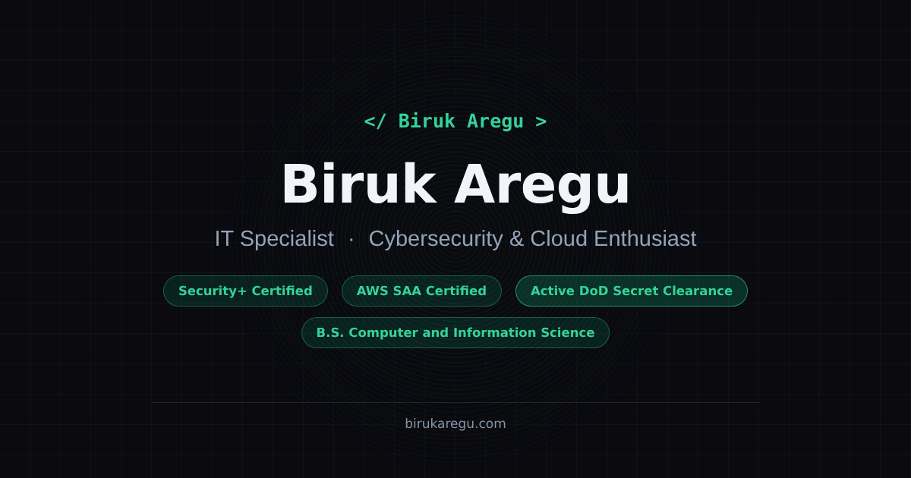

# birukaregu.com — Personal Portfolio

The source for **[www.birukaregu.com](https://www.birukaregu.com)**, the personal portfolio of **Biruk Aregu**: IT Specialist (Tier II) focused on cybersecurity, cloud and AI.



## Overview

A fast, accessible, single-page portfolio that showcases security, cloud and web projects, work experience, certifications and education. The whole site is hand-coded and ships as **one HTML file** with no build step and no framework.

## Features

- **Interactive 3D hero:** a rotating desk scene built with Three.js
- **Project case studies and live demos:** SOC triage console, honeypot threat map, phishing simulator, AWS Terraform walkthrough, AI resume analyzer and more, opened in in-page modals
- **Credential wall:** certifications and awards presented as an auto-advancing stack of cards
- **Auto-playing skills panel:** tabbed skill categories with swipe support on mobile
- **Resume viewer:** a clean document view with print and one-click PDF download
- **Bilingual:** full English and Amharic (አማርኛ) language toggle
- **Mobile-first navigation:** a full-screen menu with a circle reveal and "decrypt" text effect
- **Keyboard shortcuts:** press `?` to see them
- **Contact form** protected by reCAPTCHA, plus a Calendly scheduling link
- **Custom 404 page** styled as a terminal
- **Privacy-friendly analytics:** cookie-free visit counts with GoatCounter (no cookie banner, no personal data)

## Accessibility and quality

- Lighthouse **100** for Accessibility, Best Practices and SEO
- Keyboard-navigable dialogs and tabs, screen-reader labels and WCAG AA color contrast
- Respects the `prefers-reduced-motion` setting
- Responsive layouts for phones, tablets and desktops

## Tech stack

| Area | Tools |
|---|---|
| Markup & styling | HTML5, CSS3 (custom properties, grid, flexbox, animations) |
| Scripting | Vanilla JavaScript |
| 3D | Three.js (r128) |
| Smooth scrolling | Lenis |
| Analytics | GoatCounter |
| Hosting | GitHub Pages with a custom domain |

## Project structure

```
├── index.html               # The entire site: markup, styles and scripts
├── 404.html                 # Custom "page not found" page
├── Biruk_Aregu_Resume.pdf   # Resume served by the Download PDF button
├── og-preview.png           # Link preview image for LinkedIn and social shares
├── favicon.ico / favicon-32.png / favicon-180.png
├── sitemap.xml
└── CNAME                    # Custom domain: www.birukaregu.com
```

## Running locally

No install needed. Clone the repo and open `index.html` in a browser, or serve the folder:

```bash
git clone https://github.com/TechPro369/BirukPortfolio.git
cd BirukPortfolio
python3 -m http.server 8000   # then visit http://localhost:8000
```

Notes: the reCAPTCHA widget only renders on the live domain, and visits are only counted on the live site.

## Contact

- Website: [birukaregu.com](https://www.birukaregu.com)
- LinkedIn: [biruk-aregu](https://www.linkedin.com/in/biruk-aregu)
- Email: [aregubq@gmail.com](mailto:aregubq@gmail.com)

## License

Released under the [MIT License](LICENSE).
